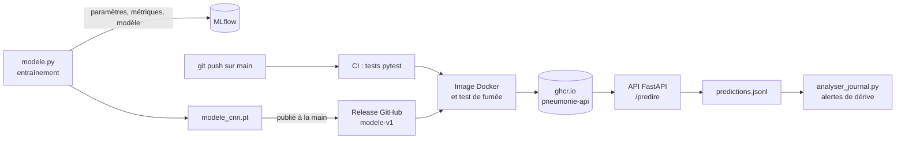

# Détection de pneumonie sur radiographies thoraciques


Projet d'apprentissage du machine learning et du MLOps. Un réseau de neurones convolutif (PyTorch) classe des radiographies thoraciques d'enfants en « normale » ou « pneumonie ». Le modèle est ensuite suivi avec MLflow, servi par une API FastAPI, conteneurisé avec Docker, testé et publié automatiquement par GitHub Actions, et surveillé une fois en service.

> **Avertissement :** c'est un projet d'apprentissage, sur des images réduites à 28 x 28 pixels. Ce n'est pas un outil de diagnostic, et il ne doit pas être utilisé sur de vrais patients.

## Pourquoi ce projet

Je suis en 3e année de BUT Informatique, et je me forme pour devenir ingénieur MLOps. Je travaille sur PathoCollab, une plateforme collaborative d'analyse médicale, dans laquelle j'aimerais à terme intégrer un modèle sur des images DICOM. Avant ça, j'ai voulu construire une chaîne complète sur un problème plus simple : de l'entraînement du modèle jusqu'à sa surveillance en production.

## Résultats

Le modèle et le seuil de décision ont été figés à partir du jeu de validation, puis le modèle a été évalué **une seule fois** sur le jeu de test.

| Seuil de 0,5 | Validation | Test |
|---|---|---|
| AUC | 0,992 | **0,933** |
| Sensibilité | 95,1 % | **95,9 %** |
| Spécificité | 97,0 % | **76,5 %** |
| Accuracy | 95,6 % | **88,6 %** |

Le chiffre à retenir est celui du test. La baisse de spécificité s'explique par un **décalage de distribution** : le jeu de test provient d'un autre lot d'images que l'entraînement et la validation, avec 37,5 % de radios normales au lieu de 26 %. Le modèle détecte toujours presque toutes les pneumonies, mais il déclenche plus de fausses alertes sur les radios normales.

Pour situer ce résultat : dans l'article de référence MedMNIST v2, un ResNet-18 (11 millions de paramètres) obtient sur ce même test, en 28 x 28, une AUC de 0,944 et une accuracy de 0,854. Mon CNN, avec environ 6 400 paramètres, est dans le même ordre de grandeur. C'est une comparaison indicative : je n'ai fait qu'un seul entraînement, et les conditions ne sont pas exactement les mêmes.

## Les données

J'utilise **PneumoniaMNIST**, issu de la collection MedMNIST v2 : des radiographies thoraciques pédiatriques, recadrées et réduites à 28 x 28 pixels en niveaux de gris.

| Split | Radios normales | Pneumonies |
|---|---|---|
| Entraînement | 1 214 | 3 494 |
| Validation | 135 | 389 |
| Test | 234 | 390 |

Les classes sont déséquilibrées : il y a environ 3 pneumonies pour 1 radio normale dans le jeu d'entraînement. Un modèle qui répondrait toujours « pneumonie » aurait déjà 74 % d'accuracy. C'est pour ça que je suis surtout la **sensibilité** (la part des pneumonies détectées), la **spécificité** (la part des radios normales reconnues) et l'**AUC**, plutôt que l'accuracy seule.

Les données sont téléchargées automatiquement par le paquet `medmnist`. Elles ne sont pas dans le dépôt.

## Le modèle

- **Architecture** (`architecture.py`) : deux blocs « convolution 3 x 3, ReLU, max pooling » (16 puis 32 filtres), puis une couche linéaire qui donne un score. 6 369 paramètres au total.
- **Entraînement** (`modele.py`) : entropie croisée binaire, avec `pos_weight` pour compenser le déséquilibre des classes ; optimiseur Adam (`lr = 0.001`) ; 20 époques ; paquets de 64 images ; graine fixée à 42 pour rendre les résultats reproductibles.
- **Seuil de décision** : 0,5, choisi sur la validation avec la règle « au moins 95 % de sensibilité, puis la meilleure spécificité possible ». Rater une pneumonie est plus grave que déclencher une fausse alerte.
- **Surapprentissage** : les pertes sur l'entraînement et sur la validation baissent ensemble pendant les 20 époques, sans écart qui se creuse.

Les principales étapes, toutes mesurées sur la validation :

| Essai | AUC |
|---|---|
| Modèle linéaire (une seule couche) | 0,957 |
| CNN entraîné avec SGD | 0,928 (sous-apprentissage : la perte ne baissait presque pas) |
| CNN entraîné avec Adam, 5 époques | 0,985 |
| CNN entraîné avec Adam, 20 époques (modèle final) | 0,992 |

## La chaîne MLOps



- **Suivi des expériences** : chaque entraînement est enregistré dans MLflow, avec ses paramètres, ses courbes de perte, son AUC et le fichier du modèle.
- **Versionnement du modèle** : le modèle final est publié dans une release GitHub (`modele-v1`), avec une description de la façon dont il a été entraîné et de ses résultats.
- **API** (`api.py`) : FastAPI, avec une route `/sante` et une route `/predire`. Le modèle est chargé une seule fois au démarrage, et les images reçues sont préparées exactement comme pendant l'entraînement.
- **Docker** : une image basée sur `python:3.12-slim`, avec la version CPU de PyTorch, beaucoup plus légère que la version GPU.
- **CI/CD** (GitHub Actions) : à chaque push sur `main`, les tests sont lancés, puis l'image est construite avec le modèle `modele-v1`, démarrée et vérifiée, et enfin publiée sur le GitHub Container Registry, avec les étiquettes `latest` et l'identifiant du commit. Sur une pull request, tout est vérifié, mais rien n'est publié.
- **Monitoring** : l'API note chaque prédiction dans un journal (probabilité, décision, luminosité moyenne de l'image), sans aucune image ni donnée patient. Un script analyse ce journal, et déclenche une alerte quand la luminosité des images ou la part de pneumonies s'écarte trop de la référence.

## Utilisation

### Installation

```bash
python -m venv .venv
# Windows : .venv\Scripts\Activate.ps1
# Linux et macOS : source .venv/bin/activate
pip install -r requirements.txt
```

Sur Linux, `pip install torch` installe par défaut la version GPU de PyTorch, qui pèse plusieurs gigaoctets. Pour la version CPU, il faut installer torch et torchvision depuis `https://download.pytorch.org/whl/cpu`, comme dans le `Dockerfile`.

### Entraîner le modèle

```bash
python modele.py      # entraîne le modèle, l'enregistre dans MLflow et le sauvegarde dans modele_cnn.pt
mlflow ui             # interface de MLflow sur http://127.0.0.1:5000
```

### Lancer l'API

```bash
uvicorn api:app --reload
```

La documentation interactive est sur http://127.0.0.1:8000/docs. Exemple de requête :

```bash
curl -F "fichier=@radio.png" http://127.0.0.1:8000/predire
```

```json
{"probabilite_pneumonie": 0.9994, "decision": "pneumonie", "seuil": 0.5}
```

Le chemin du modèle peut être changé avec la variable d'environnement `CHEMIN_MODELE`, et celui du journal avec `CHEMIN_JOURNAL`.

### Avec Docker

Le fichier `modele_cnn.pt` doit être présent à la racine du projet : soit après un entraînement, soit téléchargé depuis la release `modele-v1`.

```bash
docker build -t pneumonie-api .
docker run --rm -p 8000:8000 pneumonie-api
```

L'image publiée par la CI est aussi disponible sur `ghcr.io/zaydc/pneumonie-api:latest`.

### Tests

```bash
pip install -r requirements-api.txt -r requirements-dev.txt
python -m pytest
```

Les tests de l'API utilisent un faux modèle aux poids aléatoires : ils vérifient le fonctionnement de l'API, pas la qualité du diagnostic.

### Monitoring

Avec l'API lancée :

```bash
python simuler_trafic.py val 200         # envoie 200 radios du jeu de validation
python simuler_trafic.py val 200 1.6     # les mêmes, éclaircies de 60 % (comme un nouvel appareil de radiologie)
python analyser_journal.py               # statistiques du journal et alertes
```

| | Référence | Radios éclaircies | Lot du test |
|---|---|---|---|
| Part de pneumonies | 71 % | 79 % | 67,5 % |
| Luminosité moyenne | 0,563 | 0,837 | 0,562 |
| Alertes | | **2** | aucune |

Avec des radios plus claires, les deux alertes se déclenchent : le modèle déclare plus de pneumonies alors que les patients sont les mêmes. Sur le lot du test, en revanche, aucune alerte, alors que le modèle s'y trompe plus souvent. Des statistiques simples ne suffisent donc pas à repérer toutes les dérives.

## Structure du dépôt

| Fichier | Rôle |
|---|---|
| `architecture.py` | l'architecture du CNN |
| `modele.py` | l'entraînement, l'évaluation, le suivi MLflow et la sauvegarde du modèle |
| `predire.py` | une prédiction sur une seule radio, sans passer par l'API |
| `api.py` | l'API FastAPI |
| `Dockerfile`, `.dockerignore`, `requirements-api.txt` | l'image Docker de l'API |
| `tests/` | les tests pytest du modèle et de l'API |
| `.github/workflows/tests.yml` | la CI/CD GitHub Actions |
| `simuler_trafic.py`, `analyser_journal.py` | la simulation de trafic et le monitoring |
| `exploration.py`, `pixels.py`, `couches.py`, `exporter_images.py` | les scripts d'exploration du début du projet |
| `requirements.txt`, `requirements-dev.txt` | les dépendances pour l'entraînement, et pour le développement et les tests |

## Limites et pistes

- Les images font 28 x 28 pixels, très loin des radiographies réelles. MedMNIST recadre aussi le centre des images avant de les réduire, alors que l'API se contente de les redimensionner : pour de vraies radios, la préparation ne serait pas identique.
- Chaque réglage n'a été entraîné qu'une fois. Les petits écarts entre deux essais peuvent venir du hasard : il faudrait plusieurs entraînements, avec des graines différentes.
- Le modèle est versionné dans une release GitHub. Avec un serveur MLflow partagé, on utiliserait plutôt son registre de modèles.
- Le monitoring repère une dérive de luminosité, mais pas toutes les dérives. Pour suivre la vraie qualité du modèle, il faudrait comparer ses prédictions aux diagnostics confirmés par les médecins.
- Pistes : l'arrêt précoce, l'augmentation de données, un modèle pré-entraîné, et surtout l'application à de vraies images DICOM dans PathoCollab.

## Ce que ce projet m'a appris

- Sur des données déséquilibrées, une bonne accuracy peut cacher un modèle presque inutile : mon premier modèle avait 87 % d'accuracy, mais déclarait malade un enfant en bonne santé sur deux.
- Le jeu de test sert une seule fois, à la fin, et c'est son résultat qu'on annonce, même s'il est moins bon que celui de la validation.
- Un meilleur modèle ne sert à rien s'il est mal entraîné : le même CNN faisait moins bien que le modèle linéaire tant qu'il était entraîné avec SGD.
- Un code qui tourne sans erreur n'est pas forcément juste : plusieurs de mes bugs ne provoquaient aucune erreur, seulement des chiffres faux.
- En production, un modèle peut se dégrader en silence : c'est tout l'intérêt du monitoring.

## Références

- Jiancheng Yang et al., *MedMNIST v2 : A large-scale lightweight benchmark for 2D and 3D biomedical image classification*, Scientific Data, 2023.
- Daniel S. Kermany et al., *Identifying Medical Diagnoses and Treatable Diseases by Image-Based Deep Learning*, Cell, 2018 (jeu de données d'origine).
- Les données PneumoniaMNIST sont distribuées sous licence CC BY 4.0.

## Auteur

Zayd, étudiant en 3e année de BUT Informatique. 
[Mon Linkedin](https://www.linkedin.com/in/zayd-crombez/)
